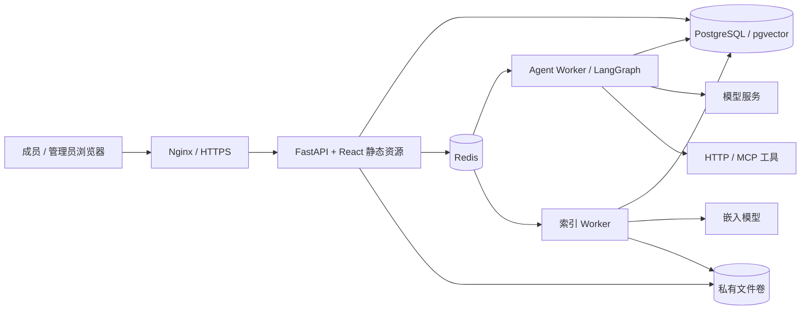

# 架构与数据边界

系统采用模块化单体 API 和独立 Celery 进程。React 构建产物与 Python API 装入同一个应用镜像；Nginx 提供统一入口。PostgreSQL 保存账号、配置、运行、事件、调用账本与 LangGraph 检查点；pgvector 用于知识片段向量。Redis 传递任务与协调执行名额。附件使用受鉴权的文件接口访问持久卷。

## 模块职责

- `app/routers`：认证、成员资源、管理配置与运行控制。依赖层重新读取账号状态与组授权。
- `app/runtime`：模型流式响应、LangGraph 状态、工具计划与执行、检查点、恢复。
- `app/worker.py`：Celery 任务入口、并发名额、定时恢复和保留期清理。
- 文档服务：上传、限额、解析、索引、检索与引用。实现状态见路线图。
- `scripts/`：配置生成、镜像冒烟、发布及备份恢复，不在脚本中放实际凭证。

## 权限与配置

成员列表只包含已发布且授权的 Agent 的名称、介绍和示例。Agent 使用权限与工具权限分别按组配置，前端隐藏控件不构成授权。请求、持久事件、附件、引用、确认和下载都必须在服务端检查当前身份及资源关系。

运行绑定服务端配置快照，发布新版本不会改变既有运行。快照并不冻结授权：恢复与执行仍校验账号、Agent、模型和工具当前状态。管理员调试也创建自己的运行，不能绕过工具授权。

连接凭证使用 Fernet 加密保存，密钥放在部署环境。连接器调用时解密；模型消息、工具参数、事件、日志、镜像和成员 DTO 不应持有凭证。更换 `ENCRYPTION_KEY` 必须同时迁移旧密文，直接替换会导致历史连接不可用。

## 副作用与恢复

模型提出调用后，服务端校验工具白名单、授权和参数，生成不可变调用记录。需要确认时，确认节点持久化后释放工作进程，执行节点独立运行。确认只绑定既定参数；重复投递先读取调用账本。

外部系统未提供幂等保证时，网络中断可能无法区分“未提交”和“已生效但响应丢失”。此时记录结果待核实并阻止后续依赖操作。管理员查证后只登记结果；平台不因核实操作再次调用工具。停止按钮同样不能撤回已经送达外部系统的操作。

生产使用 PostgreSQL 检查点和 Redis 协调；SQLite 只用于本地开发及隔离单元测试。容器中执行进程与 API 必须使用同一版本、数据库、加密密钥和文件卷。沙盒接口保持禁用，OpenSandbox 属于下一阶段。

参考：[LangGraph 中断与恢复](https://docs.langchain.com/oss/python/langgraph/interrupts)、[Docker 多阶段构建](https://docs.docker.com/build/building/multi-stage/)。
